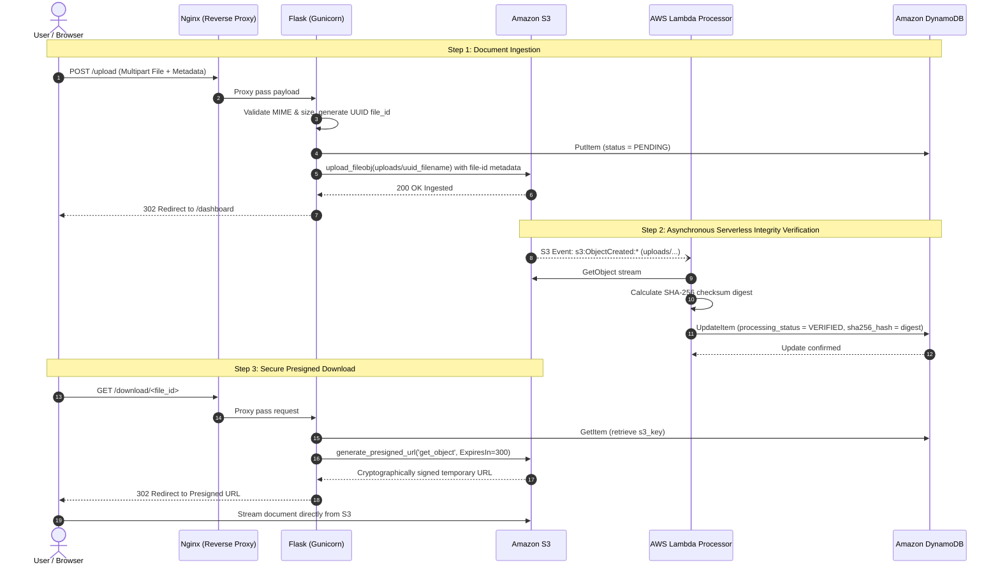

# CloudHost Architecture & Security Specification

## 1. Architectural Overview

**CloudHost: AWS Web Hosting and File Storage Portal** demonstrates an enterprise-grade cloud architecture for the **B.Tech CSE Cloud Computing Lab**. 

The system pairs compute on **Amazon EC2 (Ubuntu 22.04 LTS)** with a serverless event-driven architecture utilizing **Amazon S3**, **Amazon DynamoDB**, and **AWS Lambda**.

---

## 2. Architecture Diagrams

### A. End-to-End Cloud Infrastructure

```mermaid
graph TD
    Client["Client Web Browser<br/>(Student / Evaluator)"]

    subgraph AWSCloud["AWS Custom VPC (10.0.0.0/16)"]
        IGW["Internet Gateway (IGW)"]

        subgraph PublicSubnet["Public Subnet (10.0.1.0/24)"]
            direction TB
            subgraph EC2Host["Amazon EC2 Instance (Ubuntu 22.04 LTS)"]
                Nginx["Hardened Nginx Reverse Proxy<br/>(Security Headers, Port 80)"]
                Gunicorn["Gunicorn WSGI Application Server<br/>(127.0.0.1:5000)"]
                Flask["Python Flask Application<br/>(app.py)"]
                Nginx -->|Proxy Pass| Gunicorn
                Gunicorn --> Flask
            end
            EC2SG["Security Group: EC2<br/>Inbound: 80 (0.0.0.0/0)<br/>Inbound: 22 (Admin IP only)"]
        end

        subgraph ServerlessTier["AWS Managed & Serverless Tier"]
            S3["Amazon S3 Storage Bucket<br/>(SSE-S3 AES-256, BPA, TLS Enforced)"]
            Lambda["AWS Lambda Function<br/>(SHA-256 Cryptographic Verification)"]
            DynamoDB["Amazon DynamoDB<br/>(Encrypted NoSQL Metadata Store)"]
            IAMProfile["IAM Instance Profile & Execution Roles<br/>(Zero Persistent Access Keys)"]
        end
    end

    Client -->|HTTP Port 80| IGW
    IGW --> Nginx
    Flask -->|boto3 API (IAM Profile)| S3
    Flask -->|boto3 API (IAM Profile)| DynamoDB
    S3 -.->|s3:ObjectCreated:* Event| Lambda
    Lambda -->|Update Verified SHA-256| DynamoDB
    EC2Host -.->|Assumes Role| IAMProfile
    Lambda -.->|Assumes Role| IAMProfile
```

---

### B. Event-Driven Security & Integrity Verification Flow



---

## 3. Infrastructure Security Baseline Parameters

| Control Dimension | Implementation Mechanism | Technical Security Value |
| :--- | :--- | :--- |
| **Compute Metadata Protection** | Amazon EC2 IMDSv2 Mandatory Tokens | Mandates session-oriented token requests (`http_tokens = "required"`, `http_put_response_hop_limit = 2`), blocking SSRF credential theft vulnerabilities. |
| **Data In-Transit Enforcement** | Amazon S3 Bucket Policy (`aws:SecureTransport`) | Explicitly denies all `s3:*` API actions initiated over unencrypted HTTP channels. |
| **Data At-Rest Encryption** | S3 (SSE-S3 AES-256), DynamoDB (KMS), EBS (Encrypted GP3) | Guarantees transparent block-level and object-level cryptographic encryption across compute volumes, NoSQL tables, and object buckets. |
| **Object Access Control** | Amazon S3 100% Block Public Access (BPA) | Enables all 4 BPA controls (`block_public_acls`, `block_public_policy`, `ignore_public_acls`, `restrict_public_buckets`), completely closing public bucket attack surfaces. |
| **Identity & Credential Hygiene** | IAM Instance Profiles & Temporary STS Tokens | Eliminates long-lived access keys (`AKIA...`) in configuration files, Git repositories, and environment variables. |
| **HTTP Hardening** | Nginx Reverse Proxy Security Headers | Injects `X-Frame-Options: DENY`, `X-Content-Type-Options: nosniff`, `X-XSS-Protection`, and `Referrer-Policy`, while disabling Nginx version banners (`server_tokens off`). |
| **Event-Driven Verification** | AWS Lambda Serverless Function | Decouples cryptographic integrity hashing from user request threads, calculating real-time SHA-256 checksums automatically. |
